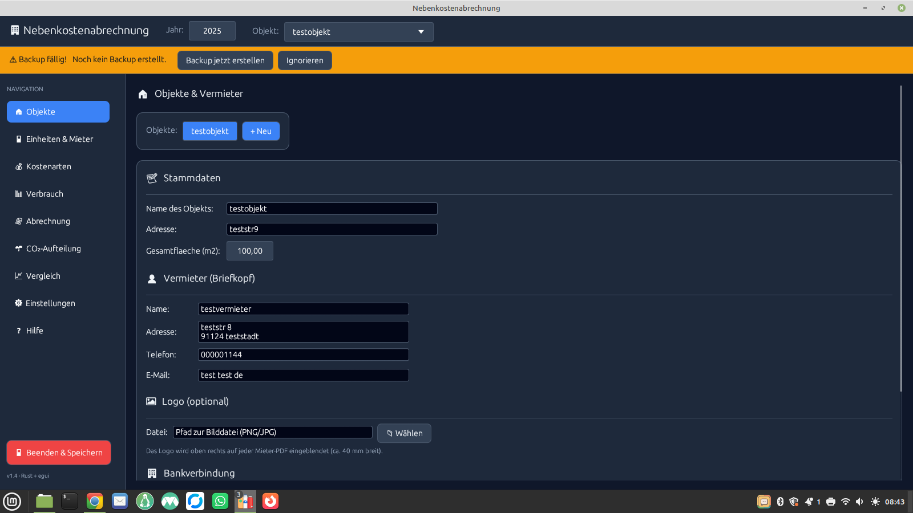

# 🏠 Nebenkostenabrechnung – in Rust geschrieben

Kostenlose, werbefreie Nebenkostenabrechnung für private Vermieter.
Native Desktop-App für **Windows** und **Linux**, geschrieben in Rust – kein Browser,
kein Electron, keine Cloud, kein Abo.

Alle Daten liegen in einer einzigen lokalen Datenbankdatei, die man einfach auf
einen USB-Stick kopieren kann.

## 📥 Download

Die aktuellen Dateien liegen unter **[Releases](https://github.com/K-Eckstein/nebenkosten-abrechnung-in-rust/releases/latest)**:

| System | Datei | Hinweis |
|---|---|---|
| Windows | `Nebenkostenabrechnung-Portable.exe` | portable, keine Installation, kein Setup |
| Linux | `Nebenkostenabrechnung-x.y.z.AppImage` | vor dem Start `chmod +x` |

Screenshots, Anleitung (`liesmich`) und die ausführliche `beschreibung` liegen
zusätzlich im Ordner [`download/`](download):

- [`download/windows/`](download/windows) – EXE, Screenshots 1–7, liesmich, beschreibung
- [`download/linux/`](download/linux) – AppImage, Screenshots 1–7, liesmich, beschreibung

## ✨ Funktionen

- **Stammdaten:** beliebig viele Objekte, Wohneinheiten und Mieter (inkl. Namenshistorie,
  Mieter-Nummern, eigene Adressen)
- **Kosten & Umlageschlüssel:** alle BetrKV-Kostenarten (unbegrenzt erweiterbar),
  Verteilung nach Wohnfläche, Personen, Verbrauch, Belegungstagen, 2-Schlüssel-Mix
  (z. B. 30/70 nach HeizkostenV) oder freier Bezugsfläche
- **CO₂-Aufteilung (CO2KostAufG):** automatisches Stufenmodell, Vermieteranteil inkl.
  19 % MwSt. von der Öl-/Gasrechnung, korrekt von den Heizkosten abgezogen
- **Zählerwechsel:** mehrere Zähler pro Einheit im laufenden Jahr, Verbrauch wird summiert
- **Centgenau:** Rundungsausgleich, Teiljahres-Mieter bei Ein-/Auszug, Leerstand,
  Vorschläge für neue Vorauszahlungen
- **PDF & Druck:** Mieteranschreiben (mit Logo) und Vermieter-Übersicht mit farbigen Salden
- **CSV-Export** für Steuererklärung / Steuerberater
- **Archivierung:** Jahres-ZIP mit allen PDFs und Rohdaten (10-Jahres-Aufbewahrung)
- **Vermieter-Journal**
- **100 % lokal:** keine Cloud, keine Telemetrie, kein Konto

## 🚀 Installation

**Windows:** Datei herunterladen, in einen Ordner deiner Wahl legen, per Doppelklick starten.
Beim ersten Start zeigt Windows ggf. „Der Computer wurde durch Windows geschützt“ –
das ist normal bei Freeware ohne kostenpflichtiges Entwicklerzertifikat:
*Weitere Informationen → Trotzdem ausführen*.

**Linux:** AppImage herunterladen, ausführbar machen
(`Rechtsklick → Eigenschaften → Ausführbar` oder `chmod +x Datei.AppImage`), starten.

**Datensicherung:** Die Datenbankdatei liegt im Programmordner – regelmäßig kopieren
oder die eingebaute Jahres-Archivierung nutzen.

## 💚 Kostenlos

Das Programm bleibt dauerhaft kostenlos und werbefrei. Wenn es dir Zeit spart, freue ich
mich über einen Erfahrungsbericht oder eine kleine freiwillige Spende:
<https://www.paypal.me/KaffekasseNebenkoste>

Anregungen und Fehlermeldungen: Eckstein-Klaus@Arcor.de
